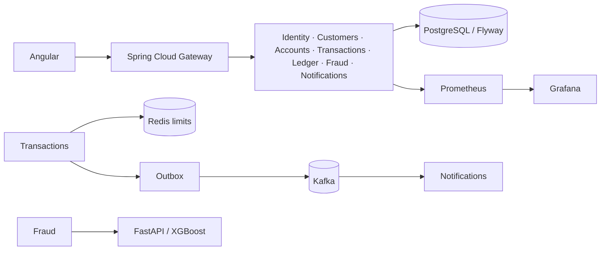

# NovaBank: Enterprise Banking Transaction Processing

Portfolio-grade simulated banking platform built with Java 21, Spring Boot 3.4, PostgreSQL, Kafka, Redis, Angular 21 and FastAPI/XGBoost. All NEFT, IMPS, RTGS, UPI and internal transfers are simulations. No external payment rail is called.

## Local environment

Supported baseline: Windows 10/11 PowerShell, JDK 21, Maven 3.9+, Node 22.12+ or 24+, npm 10+, Python 3.11, Docker Desktop with Compose v2, and optionally kubectl/k6. Install the missing command-line tools with `winget install EclipseAdoptium.Temurin.21.JDK`, `winget install Apache.Maven`, `winget install OpenJS.NodeJS.LTS`, `winget install Python.Python.3.11`, and `winget install Docker.DockerDesktop`. The checked environment had Node 24.14.1, npm 11.11.0, Python 3.11.9, Docker 29.6.2 and kubectl 1.36.1; JDK 21.0.12 was installed but not on PATH, Maven was absent, and Docker Desktop's Linux engine was not running.

## Run locally (PowerShell)

```powershell
Copy-Item .env.example .env
# Edit .env and choose local-only secrets before using this beyond a private demo.
docker compose up --build
```

If `java` is installed but not on the current PowerShell PATH, set it for this terminal with:

```powershell
$jdkPath = Get-ChildItem 'C:\Program Files\Eclipse Adoptium' -Directory | Sort-Object Name -Descending | Select-Object -First 1 -ExpandProperty FullName
$env:JAVA_HOME = $jdkPath
$env:Path = "$env:JAVA_HOME\bin;$env:Path"
```

Open the Angular app at http://localhost:4200. The gateway listens at http://localhost:${API_GATEWAY_HOST_PORT:-8080}. If host port 8080 is in use, set `$env:API_GATEWAY_HOST_PORT='8088'` before `docker compose up --build`. The OpenAPI overview is [`docs/openapi.yaml`](docs/openapi.yaml). Demo credentials are seeded by identity-service: `admin / AdminPassw0rd!` and `analyst / AnalystPassw0rd!`; change or remove these before any shared deployment. Register a customer through the UI for a regular account.

To stop containers, run `docker compose down`; `docker compose down -v` also deletes local PostgreSQL data. Optional MongoDB and observability profile: `docker compose --profile mongo --profile obs up --build`. PostgreSQL data is initialized as seven service databases and each service applies its own Flyway migrations. Newly opened accounts start at zero; there is no endpoint that mints demo funds.

### Run components directly

```powershell
mvn clean verify
mvn -pl services/identity-service spring-boot:run
Set-Location frontend
npm install
npm start
```

Start PostgreSQL, Redis, Kafka, and the remaining services with Compose first when running a component outside Compose. To train and run fraud prediction locally:

```powershell
py -3.11 -m venv .venv
.\.venv\Scripts\Activate.ps1
python -m pip install -r ml-fraud/requirements.txt
python ml-fraud/train.py
uvicorn ml-fraud.app:app --host 127.0.0.1 --port 8090
```

`train.py` writes model and computed evaluation metrics under `ml-fraud/models/`; that directory is git-ignored. The measured synthetic-data metrics from this run are summarized in [`docs/fraud-model-evaluation.md`](docs/fraud-model-evaluation.md). Training data is synthetic and suitable only for a demonstration, not real fraud decisions.

## Services and API

| Service | Port | Scope |
|---|---:|---|
| API Gateway | 8080 | Routing and JWT validation |
| Identity | 8081 | Registration, login, refresh rotation, logout, roles |
| Customers | 8082 | Customer profile and admin listing |
| Accounts | 8083 | Account, fixed deposits, loan applications |
| Transactions | 8084 | Transfers, history, statements, scheduled payments |
| Ledger | 8085 | Immutable double-entry journal and reconciliation |
| Fraud | 8086 | Risk alerts and analyst review |
| Notifications | 8087 | Kafka-driven notification inbox |
| Fraud ML | 8090 | FastAPI prediction and model metrics |

Main routes: `POST /api/v1/auth/register`, `/login`, `/refresh`, `/logout`; `GET/PUT /api/v1/customers/me`; `POST/GET /api/v1/accounts`; `POST/GET /api/v1/transfers` (supply `Idempotency-Key`); `GET /api/v1/statements/{accountId}`; `POST/GET /api/v1/scheduled-payments`; `POST /api/v1/fixed-deposits`; `POST/GET /api/v1/loans`; `GET /api/v1/ledger/accounts/{accountId}`, `POST /api/v1/ledger/reconcile`; `GET /api/v1/fraud/alerts`; `GET /api/v1/notifications`. The OpenAPI overview is in [`docs/openapi.yaml`](docs/openapi.yaml); request validation details are in each controller.

## Architecture and data safety



Full source diagram: [`docs/architecture.mmd`](docs/architecture.mmd). Services use PostgreSQL `NUMERIC`, Java `BigDecimal`, database checks, pessimistic account locks in stable ID order, idempotency keys, hashed refresh tokens, role checks, and database-enforced append-only balanced journal entries. Account commands are idempotent by transfer ID, so a retried HTTP call cannot debit twice. The transaction service writes notification/fraud events to an outbox, and the publisher retries delivery. The services currently use separate databases in one PostgreSQL instance.

**Known consistency boundary:** balance updates, ledger posting, and the transfer row span services and are HTTP calls, not one distributed ACID transaction. This scaffold has an outbox for events and transfer idempotency, but does not yet implement a durable saga/compensation for every partial failure across account and ledger services. Treat this as an interview/demo project; do not use it to hold real customer funds. A production evolution should make the ledger the posting authority and implement a stateful transfer saga with idempotent debit/credit commands, recovery, and reconciliation before settlement.

Documented recovery behavior: [`docs/failure-recovery.md`](docs/failure-recovery.md).

## Build and verification

```powershell
mvn clean verify
Set-Location frontend; npm ci; npm run build
docker compose config --quiet
docker compose up --build
```

Run the Python metrics command above. k6 smoke load (after login, set a valid token): `$env:ACCESS_TOKEN='<token>'; k6 run k6/transfers.js`. This script exercises authenticated account listing only and does not create financial load. Prometheus is exposed on 9090 and Grafana on 3000 under the `obs` profile. Spring actuator Prometheus endpoints are exposed at `/actuator/prometheus`.

## Repository map

`services/` contains independently packaged Spring services; `libs/common/` holds shared money, JWT and API utilities; `frontend/` contains Angular UI; `ml-fraud/` contains training and inference; `infra/` contains Compose, database bootstrap, container, monitoring and Kubernetes configuration; `k6/` contains a smoke script; `.github/workflows/ci.yml` runs Maven, Angular and model training CI.

## Kubernetes

Compose is the supported complete local environment. Kubernetes deployment prerequisites and image build notes are in [`infra/k8s/README.md`](infra/k8s/README.md); there are no cluster manifests yet because an image registry and cluster target have not been selected.

## Security and operations

Never use the demo credentials or Compose defaults outside a private local environment. Supply strong secrets through a secret manager, terminate TLS at the ingress, restrict service-to-service network access, rotate credentials, back up PostgreSQL, and alert on failed/retried outbox events and reconciliation differences. Refresh tokens are rotated and stored hashed. Payment channels are simulated and no payment-rail credentials are present.


## Nova AI and customer analytics

The dashboard now includes a connected six-month outflow chart derived from the signed-in customer's transfer feed and a Nova AI chat screen. The assistant endpoint is documented in [`docs/assistant.md`](docs/assistant.md) and [`docs/assistant-openapi.yaml`](docs/assistant-openapi.yaml). It is an authenticated, deterministic allow-list assistant rather than a generative LLM: it can summarize only the caller's recorded balances, transfer activity and completed outflows; it will not initiate a payment. Redis limits the assistant to 20 requests per customer per minute. Audit records store the intent and a SHA-256 prompt hash, not raw chat text. No third-party model receives customer data. Account access for the assistant uses a token-protected internal account-service endpoint.

Verification in this environment: the full Java 21 reactor passed with `mvn -DskipITs -DforkCount=0 clean verify`; eight unit tests passed across money and transaction services. The identity Testcontainers integration test was skipped because Docker is unavailable. The Angular production bundle passed with `node frontend/node_modules/@angular/cli/bin/ng.js build --progress=false`; all three fraud model unit tests passed after training/loading the local model. Docker Compose configuration validates, but the Docker engine is unavailable here, so service startup and end-to-end flows remain unverified. A workspace-local Maven cache was used because this process cannot write to the global `.m2` cache; the temporary cache was removed after verification.
